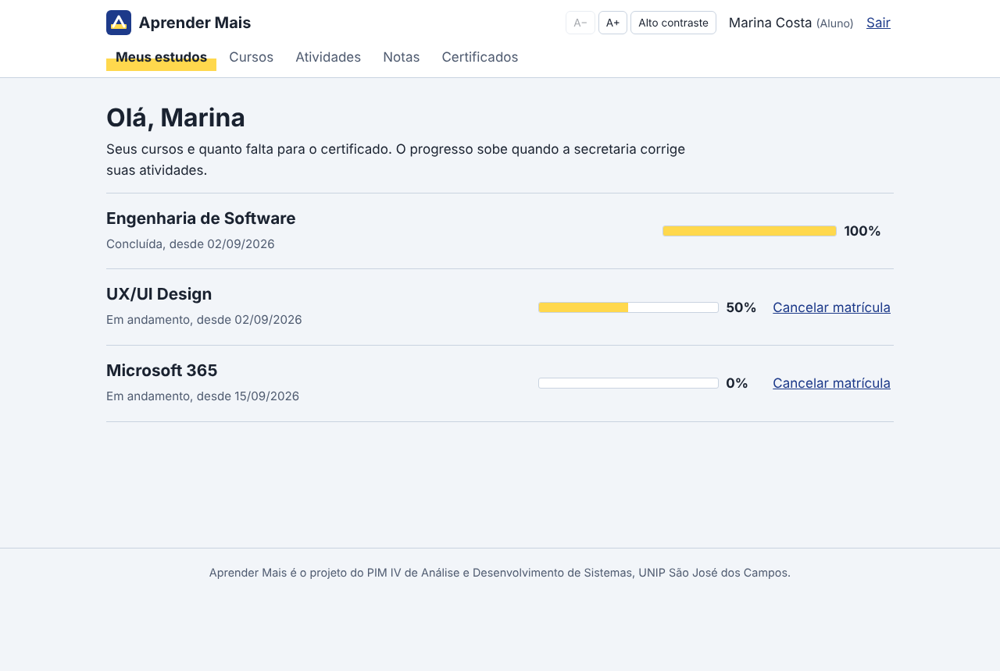
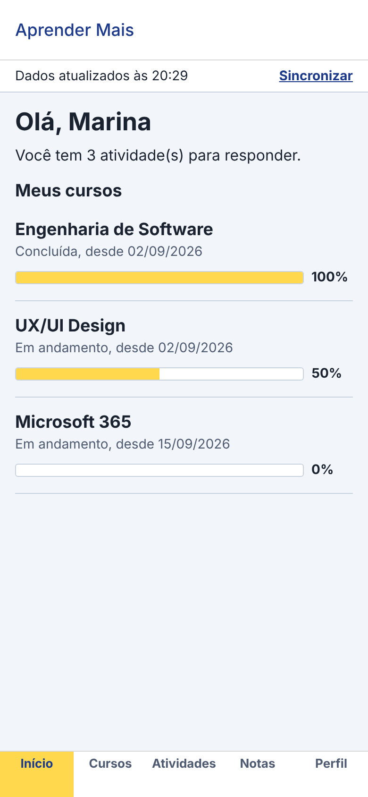

# Aprender Mais – PIM IV


**Projeto Integrado Multidisciplinar IV** do Curso Superior de Tecnologia em Análise e Desenvolvimento de Sistemas, UNIP São José dos Campos, 2026.

**Tema:** desenvolvimento e implantação de uma solução tecnológica corporativa integrada para apoiar a transformação digital de uma empresa. É a continuação do [PIM III](https://github.com/souzaa7/PIM_III), onde foram feitos o levantamento de requisitos e a modelagem.

**Aprender Mais** é uma plataforma educacional de cursos de tecnologia com três perfis (**Aluno**, **Secretaria** e **Administrador**), disponível em **web, mobile e desktop**, todos ligados a uma API REST em .NET e a um banco SQL Server.

| Site (web) | App (mobile) | Desktop |
|---|---|---|
|  |  | Windows Forms em C#: mesmas regras de negócio da API |

## Equipe

| Integrante | RA | Papel |
|---|---|---|
| Gabriel Souza Maciel | R413020 | Scrum Master, front-end web e mobile |
| Vitor Gabriel Pereira Geraldo | R8664A1 | Back-end C#/.NET e desktop |
| Julia Peneluppi de Faria | R952355 | Product Owner, UX e documentação |
| Lucas Ferreira Tomé | R958752 | Banco de dados e DevOps |

## Sumário

- [Estrutura do repositório](#estrutura-do-repositório)
- [Tecnologias](#tecnologias)
- [Como rodar](#como-rodar)
- [Contas de demonstração](#contas-de-demonstração)
- [Etapas do manual](#etapas-do-manual)
- [Sprints](#sprints)

## Estrutura do repositório

```text
PIM_IV/
├── backend/        C# / .NET 10: API REST, regras de negócio, desktop WinForms e testes  → backend/README.md
├── web/            Site em React + JavaScript (Vite)                                       → web/README.md
├── mobile/         App em React Native + Expo (JavaScript), com modo offline               → mobile/README.md
├── database/       Scripts SQL Server: tabelas, views, procedures, triggers e dados        → database/README.md
├── docs/           Documentação das 9 etapas do manual, diagramas UML e capturas de tela   → docs/README.md
├── .github/        CI no GitHub Actions (build e testes a cada push)
├── docker-compose.yml   Sobe banco + API + site com um comando
└── CONTRIBUTING.md      Padrão de branches e commits do time
```

## Tecnologias

| Parte | Tecnologia |
|---|---|
| Back-end / API | C#, .NET 10, ASP.NET Core Web API, token Bearer, Swagger, ADO.NET (Microsoft.Data.SqlClient), BCrypt |
| Desktop | C#, Windows Forms (.NET 10) |
| Web | React 19, JavaScript, Vite, React Router |
| Mobile | React Native, Expo, React Navigation, AsyncStorage |
| Banco de dados | Microsoft SQL Server (T-SQL: procedures, triggers, views) |
| Testes | xUnit (49 testes) |
| DevOps | Docker, docker-compose, GitHub Actions; plano de nuvem na Microsoft Azure |
| Modelagem | Astah UML, PlantUML |

## Como rodar

### Jeito rápido (sem instalar banco)

A API vem configurada para usar **dados em memória**, com os mesmos dados de demonstração do banco.

```bash
# 1) API (precisa do .NET 10 SDK)
cd backend
dotnet run --project AprenderMais.Api        # http://localhost:5000/swagger

# 2) Site (outro terminal; precisa do Node.js 22)
cd web
npm install
npm run dev                                  # http://localhost:5173

# 3) App (outro terminal)
cd mobile
npm install
npx expo start                               # tecla "w" abre no navegador; QR Code abre no Expo Go

# 4) Desktop (Windows)
cd backend
dotnet run --project AprenderMais.Desktop
```

### Com SQL Server

1. Execute [`database/script_completo.sql`](database/script_completo.sql) no SQL Server (SSMS ou Azure Data Studio).
2. Em `backend/AprenderMais.Api/appsettings.json` (e no `appsettings.json` do Desktop), troque `"Tipo": "Memoria"` por `"Tipo": "SqlServer"` e ajuste a connection string.

### Com Docker (tudo de uma vez)

```bash
docker compose up --build
```

Site em <http://localhost:8080>, API em <http://localhost:5000/swagger>, SQL Server em `localhost,1433`.

## Contas de demonstração

Senha de todas: **`123456`**

| Perfil | E-mail | Onde usar |
|---|---|---|
| Aluno | `aluno@aprendermais.com` (Marina) | Web, mobile e desktop |
| Aluno | `bruno@aprendermais.com` (Bruno) | Web, mobile e desktop |
| Secretaria | `secretaria@aprendermais.com` | Web e desktop |
| Administrador | `admin@aprendermais.com` | Web e desktop |
| Aluno inativo | `ana@aprendermais.com` | Testar o bloqueio de acesso |

Código de certificado para testar a validação: `AM-2026-7F3A9C21`.

## Etapas do manual

| Etapa | Onde está | Pontos |
|---|---|---|
| 1. Caracterização da organização | [docs/01](docs/01-caracterizacao-da-organizacao.md) | 1,0 |
| 2. Planejamento da solução (Empreendedorismo) | [docs/02](docs/02-planejamento-da-solucao.md) | 1,0 |
| 3. Responsabilidade social e diversidade | [docs/03](docs/03-responsabilidade-social-e-diversidade.md) e `web/src/componentes/Acessibilidade.jsx` | 0,5 |
| 4. Solução Web | [docs/04](docs/04-solucao-web.md), `backend/AprenderMais.Api` e `web/` | 2,0 |
| 5. Solução Mobile | [docs/05](docs/05-solucao-mobile.md) e `mobile/` | 2,0 |
| 6. Arquitetura de Software | [docs/06](docs/06-arquitetura-de-software.md) e `backend/` | — |
| 7. Banco de Dados | [docs/07](docs/07-banco-de-dados.md) e `database/` | 1,0 |
| 8. Nuvem e DevOps | [docs/08](docs/08-nuvem-e-devops.md), `docker-compose.yml` e `.github/workflows` | 0,5 |
| 9. Gerenciamento Ágil | [docs/09](docs/09-gerenciamento-agil.md) | 1,0 |

Diagramas UML (casos de uso, classes, sequência, atividade, MER, arquitetura): [`docs/diagramas`](docs/diagramas).

## Sprints

Scrum com sprints de **1 semana**, de 01/09/2026 a 23/11/2026. O backlog completo, o Sprint Backlog de cada sprint, o Kanban e as entregas estão em [docs/09-gerenciamento-agil.md](docs/09-gerenciamento-agil.md).

| Sprint | Período | Entregas | Status |
|---|---|---|---|
| S1 | 01/09 – 07/09 | Kick-off, revisão do PIM III, caracterização, modelo de negócio, Product Backlog | ✅ Concluída |
| S2 | 08/09 – 14/09 | Arquitetura em camadas; banco migrado para SQL Server (MER, modelos lógico e físico) | ✅ Concluída |
| S3 | 15/09 – 21/09 | Domínio e Aplicação em C# (login, conteúdos, matrículas) e testes xUnit | ✅ Concluída |
| S4 | 22/09 – 28/09 | Procedures, triggers, views, dados iniciais e repositórios SQL | ✅ Concluída |
| S5 | 29/09 – 05/10 | API REST, token Bearer, Swagger; atividades, notas e certificados | ✅ Concluída |
| S6 | 06/10 – 12/10 | Site React: login, cadastro e área do aluno | ✅ Concluída |
| S7 | 13/10 – 19/10 | Site React: secretaria, administração, relatórios e acessibilidade | ✅ Concluída |
| S8 | 20/10 – 26/10 | App mobile: telas, navegação e sincronização offline | ✅ Concluída |
| S9 | 27/10 – 02/11 | Desktop WinForms, diagramas de atividade, Docker e CI | 🔄 Em andamento |
| S10 | 03/11 – 09/11 | Testes integrados com SQL Server e homologação com usuários | ⏳ Planejada |
| S11 | 10/11 – 16/11 | Documento final em ABNT | ⏳ Planejada |
| S12 | 17/11 – 23/11 | Revisão, apresentação e entrega na UNIP | ⏳ Planejada |
