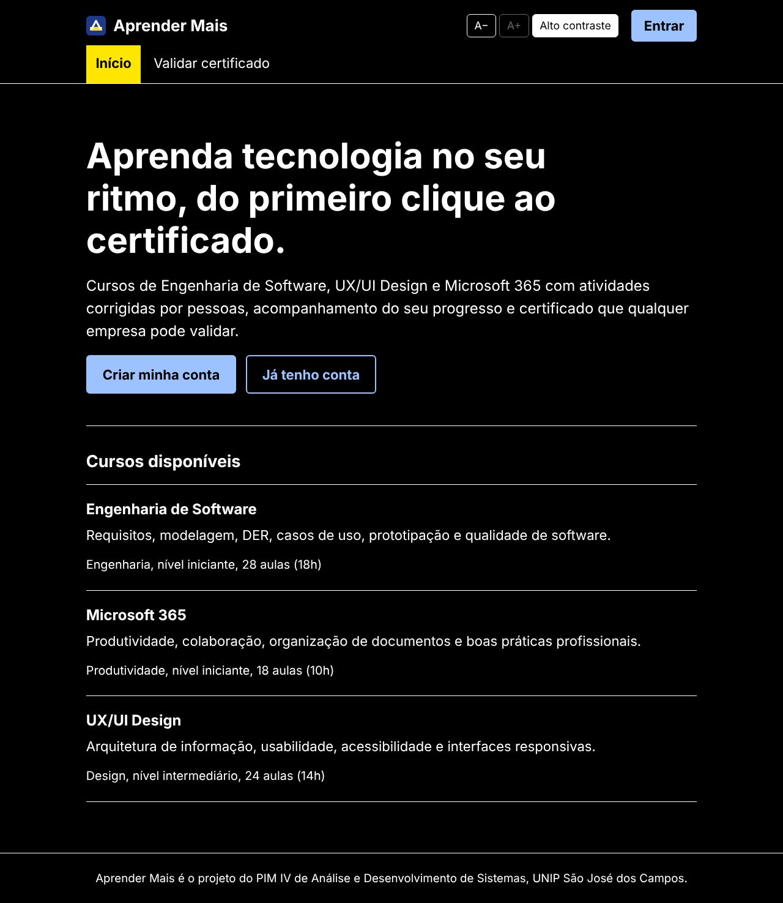

# Etapa 3 – Responsabilidade social e diversidade

*Disciplina: Relações étnico-raciais e afrodescendência (EAD)*

A tecnologia só transforma quando é acessível a todos. Abaixo estão as ações **já implementadas no código** e as **ações propostas** para a operação da escola.

## Combate à discriminação

- **Cadastro mínimo**: o sistema pede só nome, CPF, e-mail e senha. Não há campos de raça, gênero, religião ou foto que possam levar a tratamento desigual na correção. A secretaria corrige a resposta, não a pessoa.
- **Mesmas regras para todos**: prazos, notas e certificados seguem regras automáticas no código e no banco (triggers), sem exceções manuais.
- **Política de conduta** (proposta): termo de uso com proibição de discriminação nos comentários de correção, e canal de denúncia pela secretaria.
- **Proteção de dados (LGPD, Lei 13.709/2018)**: senhas guardadas com hash BCrypt e dados mínimos coletados.

## Valorização da diversidade

- **Conteúdos com referências diversas** (proposta): incluir nos cursos casos e profissionais negros, indígenas e mulheres da tecnologia, atendendo ao espírito da **Lei 10.639/2003** (história e cultura afro-brasileira na educação).
- **Bolsas de estudo** (proposta): parte das vagas pagas financia vagas gratuitas para estudantes de escola pública, com prioridade para pretos, pardos e indígenas, em parceria com ONGs da região.
- **Linguagem inclusiva e simples** em todas as telas, pensada para quem está começando.

## Recursos tecnológicos inclusivos (implementados)

| Recurso | Onde | Arquivo |
|---|---|---|
| Fonte **Atkinson Hyperlegible**, criada para pessoas com baixa visão | Web | `web/index.html` |
| Botões **A− / A+** para aumentar o texto | Web | `web/src/componentes/Acessibilidade.jsx` |
| **Alto contraste** (fundo preto, texto branco, destaques amarelos) | Web | `web/src/index.css` |
| Preferências salvas para a próxima visita | Web | `Acessibilidade.jsx` |
| **App offline** para quem tem internet limitada ou plano de dados pequeno | Mobile | `mobile/src/servicos/sincronizacao.js` |
| Funciona em celulares simples, pelo navegador ou pelo app | Web e mobile | layout responsivo |

## Ações voltadas à acessibilidade (WCAG 2.1 e Lei 13.146/2015)

- **Link "Pular para o conteúdo"** para quem navega pelo teclado ou por leitor de tela.
- **Foco visível** (contorno azul de 3px) em todos os elementos clicáveis.
- **Rótulos visíveis** em todos os campos de formulário (não só placeholder).
- **Atributos ARIA**: `role="progressbar"`, `aria-live` nas mensagens, `aria-pressed` e `aria-expanded` nos botões.
- **Contraste** das cores dentro do nível AA da WCAG (texto `#1A2230` sobre `#F2F5F9`).
- Tabelas com `<caption>` e `<th scope>` para leitores de tela.
- Respeito à preferência **"reduzir movimento"** do sistema operacional.
- No mobile: `accessibilityRole`, `accessibilityLabel` e `accessibilityLiveRegion` nos componentes.

## Utilização da tecnologia para promoção da cidadania

- **Empregabilidade**: cursos de Microsoft 365 e de Fundamentos de TI preparam para vagas administrativas e técnicas.
- **Certificado validável**: o aluno comprova o que aprendeu para qualquer empresa, sem burocracia (`/validar-certificado`).
- **Inclusão digital** (proposta): oficinas gratuitas em parceria com escolas públicas de São José dos Campos, usando a própria plataforma.
- **Acesso sem barreiras**: o visitante vê o catálogo sem cadastro e só precisa criar conta quando decide estudar.
