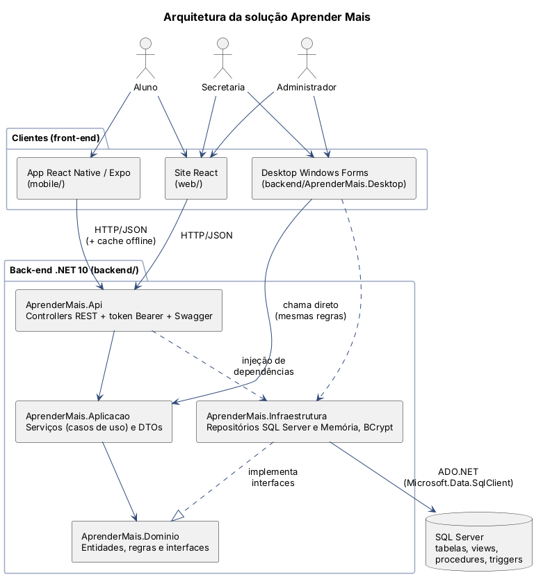
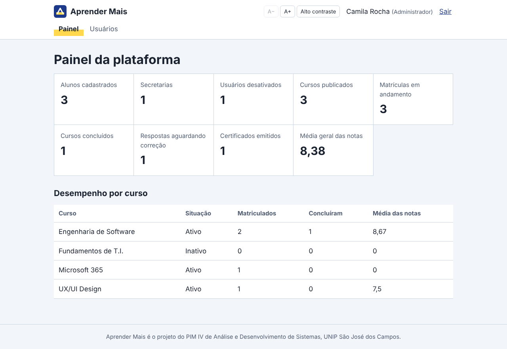
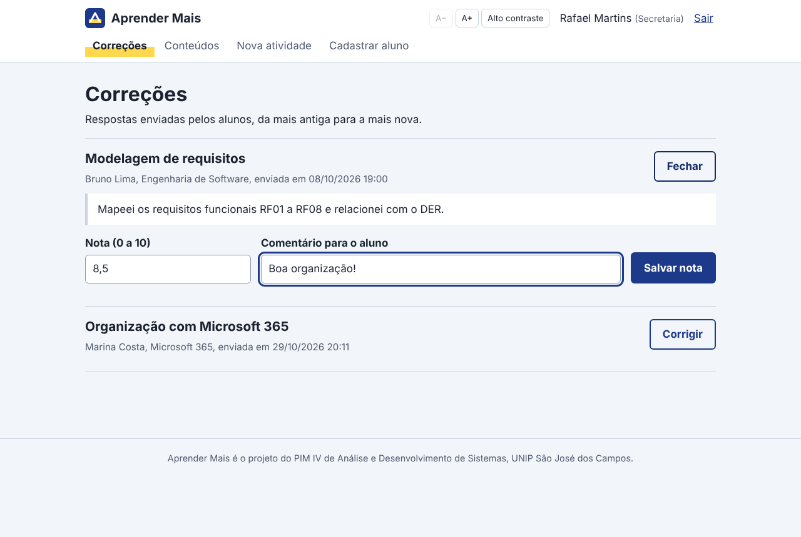
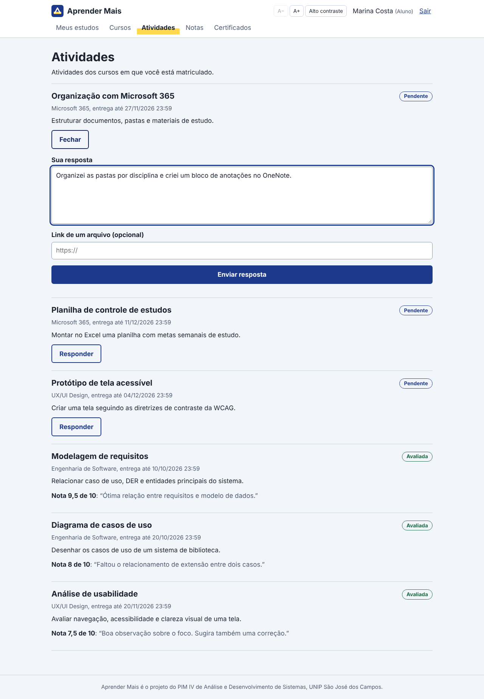
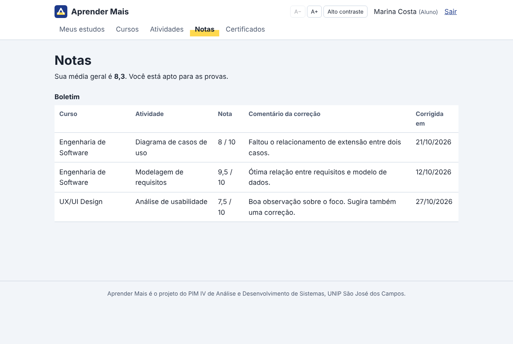
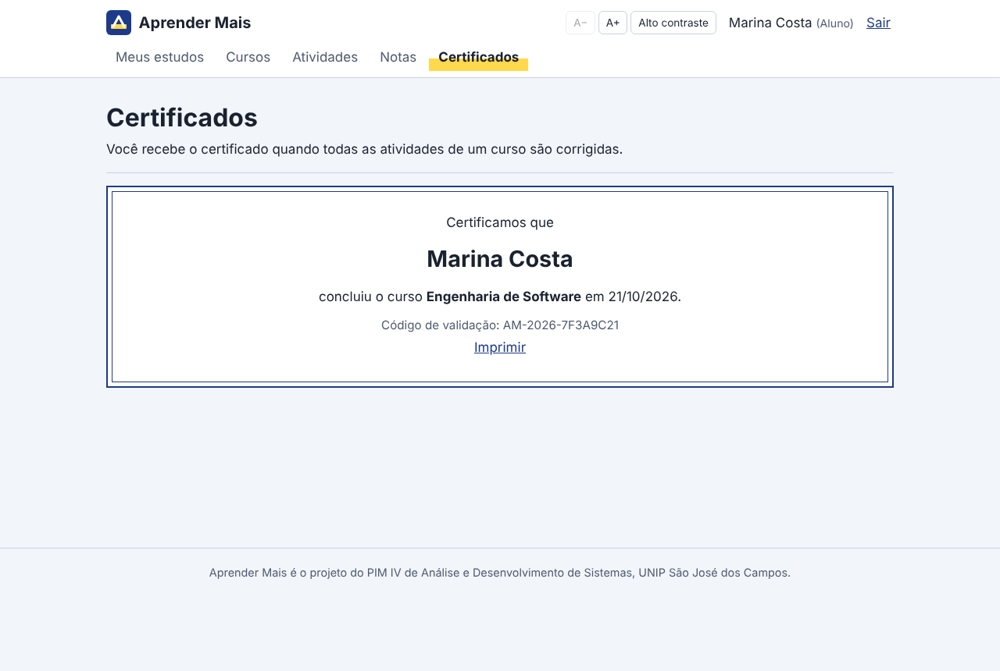
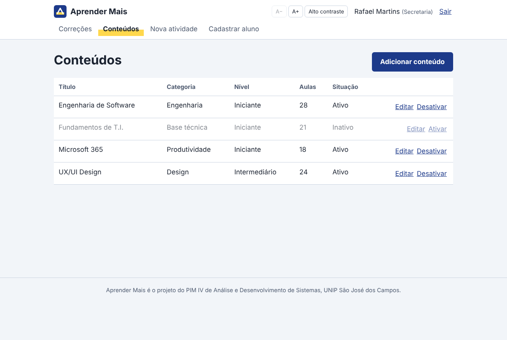

# Etapa 4 – Desenvolvimento da solução Web

*Disciplina: Desenvolvimento Web com .NET*

A solução web tem duas partes:

- **API REST em ASP.NET Core (.NET 10)**, em `backend/AprenderMais.Api`. É o "coração" do sistema, usado pelo site, pelo app e (indiretamente) pelo desktop.
- **Site em React + JavaScript (Vite)**, em `web/`. É a interface para os três perfis.

## Arquitetura da aplicação



```text
Navegador (React)  ──HTTP/JSON──▶  API ASP.NET Core  ──▶  Serviços (Aplicação)  ──▶  Repositórios  ──▶  SQL Server
   web/src/servicos/api.js          Controllers/            Servicos/                 SqlServer/          database/
```

**Organização do site React (`web/src`):**

| Pasta | Conteúdo |
|---|---|
| `servicos/api.js` | Todas as chamadas à API em um só lugar (`fetch` + token) |
| `servicos/useCarregar.js` | Hook que carrega dados e trata "carregando" e erro |
| `contexto/AuthContext.jsx` | Usuário logado, login e logout, disponível para todas as telas |
| `componentes/` | Layout (topo e menu por perfil), rota protegida, barra de acessibilidade, avisos e barra de progresso |
| `paginas/publico` | Início, Entrar, Cadastro e Validar certificado |
| `paginas/aluno` | Meus estudos, Cursos, Atividades, Notas e Certificados |
| `paginas/secretaria` | Correções, Conteúdos, Nova atividade e Cadastrar aluno |
| `paginas/admin` | Painel (relatórios) e Usuários |

## APIs REST

Documentação interativa: **Swagger** em `http://localhost:5000/swagger`.

| Método | Rota | Perfil | Caso de uso |
|---|---|---|---|
| POST | `/api/auth/login` | público | UC01 – Acessar sistema |
| POST | `/api/auth/cadastro` | público | UC02 – Realizar cadastro |
| GET | `/api/auth/eu` | logado | Dados do usuário do token |
| GET | `/api/conteudos` | público | Catálogo de cursos ativos |
| GET | `/api/conteudos/{id}` | público | Detalhe do curso |
| GET | `/api/conteudos/{id}/atividades` | logado | Atividades do curso |
| GET | `/api/conteudos/todos` | Secretaria | Gestão (inclui inativos) |
| POST | `/api/conteudos` | Secretaria | UC07 – Adicionar conteúdo |
| PUT | `/api/conteudos/{id}` | Secretaria | UC08 – Editar conteúdo |
| PATCH | `/api/conteudos/{id}/ativo` | Secretaria | UC09 – Desativar conteúdo |
| POST | `/api/atividades` | Secretaria | Criar atividade |
| GET | `/api/atividades/minhas` | Aluno | UC03 – Atividades e situação |
| GET | `/api/matriculas/minhas` | Aluno | Matrículas e progresso |
| POST | `/api/matriculas` | Aluno | Matricular-se |
| DELETE | `/api/matriculas/{id}` | Aluno | Cancelar matrícula |
| POST | `/api/respostas` | Aluno | UC04 – Realizar avaliação |
| GET | `/api/respostas/pendentes` | Secretaria | UC06 – Fila de correção |
| POST | `/api/respostas/{id}/nota` | Secretaria | UC06 – Avaliar atividade |
| GET | `/api/notas/minhas` | Aluno | UC05 – Acessar notas |
| GET | `/api/certificados/meus` | Aluno | Certificados |
| GET | `/api/certificados/validar/{codigo}` | público | Validação de certificado |
| GET | `/api/usuarios` | Admin | Lista de usuários |
| POST | `/api/usuarios` | Admin / Secretaria | UC10 – Cadastrar secretaria (ou aluno) |
| PATCH | `/api/usuarios/{id}/ativo` | Admin | UC11 – Desativar cadastro |
| GET | `/api/relatorios/resumo` | Admin | Indicadores |
| GET | `/api/relatorios/conteudos` | Admin | Desempenho por curso |
| GET | `/api/sincronizacao` | Aluno | Pacote para o app offline |
| GET | `/saude` | público | Health check (monitoramento) |

**Padrão das respostas:** JSON em camelCase; erros sempre no formato `{ "mensagem": "..." }`.

| Código | Quando |
|---|---|
| 200 / 201 / 204 | Sucesso / criado / sem conteúdo |
| 400 | Regra de negócio violada (ex.: "A nota não pode ser maior que a nota máxima") |
| 401 | Sem token ou token inválido |
| 403 | Perfil sem permissão (ex.: aluno chamando relatórios) |
| 500 | Erro inesperado (registrado no log) |

## Autenticação

1. O usuário envia e-mail e senha para `POST /api/auth/login`.
2. A API confere a senha com **BCrypt** (`BCryptPasswordHasher`) e bloqueia usuários inativos.
3. A API devolve um **token Bearer** (`accessToken`) com validade de 8 horas. O token é gerado e criptografado pelo próprio ASP.NET Core (`AddBearerToken`) e carrega as *claims* id, nome, e-mail e **perfil (role)**.
4. O site guarda o token e o envia em todas as requisições no cabeçalho `Authorization: Bearer <token>`.
5. Os controllers usam `[Authorize(Roles = "Secretaria")]` e outros perfis para liberar cada rota.
6. A cada requisição, `BaseController.UsuarioLogadoAsync()` busca o usuário no banco. **Se o ADM desativou a conta, o token antigo para de funcionar na hora.**

## Segurança

| Ameaça | Proteção | Onde |
|---|---|---|
| Vazamento de senha | Hash BCrypt com *salt*; a senha nunca é salva em texto | `Infraestrutura/Seguranca` |
| Descobrir e-mails cadastrados | Mesma mensagem para e-mail inexistente e senha errada | `AutenticacaoService` |
| Acesso indevido | Token Bearer + autorização por perfil em cada rota, e o serviço confere o perfil de novo | Controllers e `Permissoes.cs` |
| SQL Injection | Todos os comandos usam **parâmetros** (`@email`, `@id`) | `Infraestrutura/SqlServer` |
| Dados inválidos | Validação no domínio (C#) **e** no banco (CHECK, UNIQUE, triggers) | `Dominio/Entidades`, `database/` |
| Site de outro domínio chamando a API | CORS liberado só para as origens configuradas | `appsettings.json` |
| Erros expondo detalhes internos | Middleware devolve mensagem genérica no erro 500 | `TratamentoDeErros.cs` |
| Segredos no GitHub | Connection string por variável de ambiente; `.gitignore` bloqueia `.env` | `.gitignore` |
| Rastreabilidade | Triggers registram ativação e desativação em `log_auditoria` | `05_triggers.sql` |

## Estrutura administrativa

- **Secretaria**: fila de correções (com nota e feedback), CRUD de conteúdos com ativar e desativar, criação de atividades com prazo e cadastro de alunos.
- **Administrador**: painel com 9 indicadores e desempenho por curso (procedures `sp_relatorio_resumo` e `sp_relatorio_por_conteudo`), lista de usuários com busca, cadastro de secretarias e ativação ou desativação de contas.

| Painel do administrador | Correções da secretaria |
|---|---|
|  |  |

## Integração entre módulos

- **Web e mobile** usam a **mesma API** e o mesmo formato de dados.
- **Desktop** usa as **mesmas classes de Aplicação e Domínio** da API (projetos compartilhados), então as regras de negócio são idênticas nas três versões.
- **Correção → progresso → certificado**: quando a secretaria salva uma nota, o `RespostaService` chama `sp_calcular_progresso`, atualiza a matrícula e, ao chegar a 100%, chama `sp_emitir_certificado`. O aluno vê o resultado no site e no app.

## Telas

| Início | Área do aluno | Atividades |
|---|---|---|
|  |  |  |

| Notas | Certificados | Conteúdos (secretaria) |
|---|---|---|
|  |  |  |

Todas as capturas estão em [`docs/imagens/web`](imagens/web).
