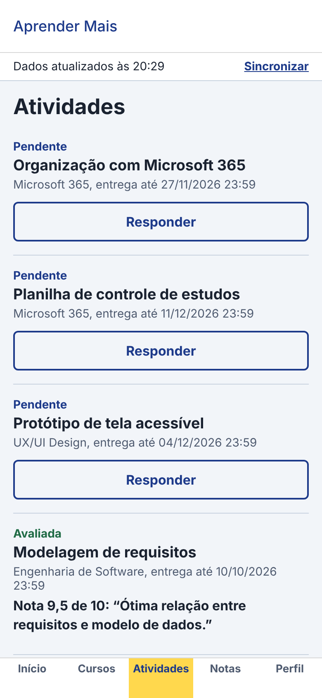
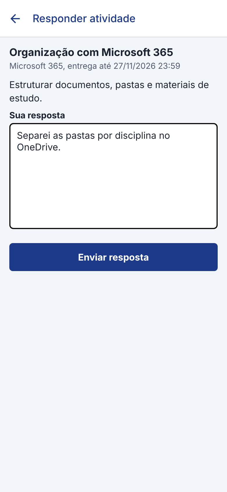
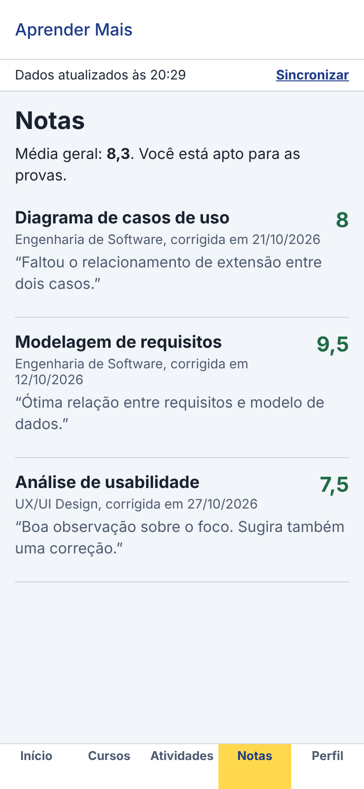
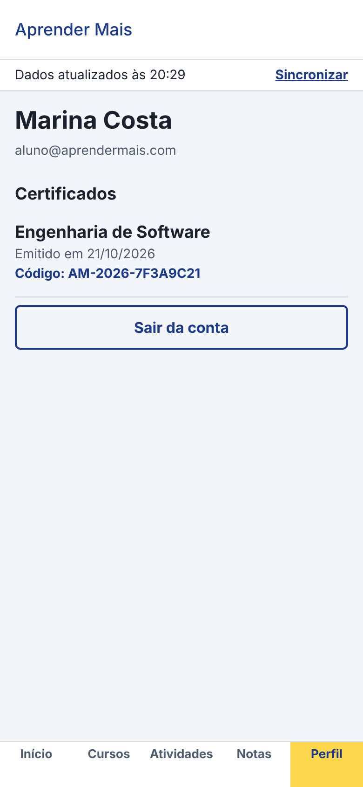
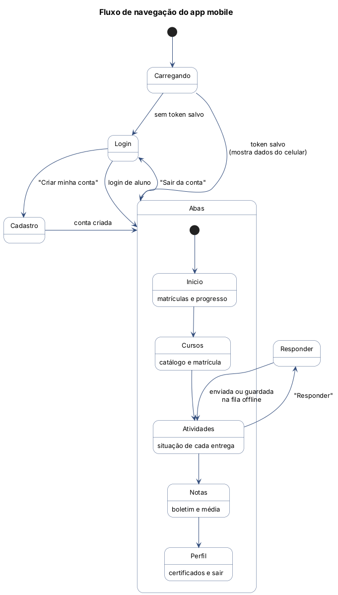
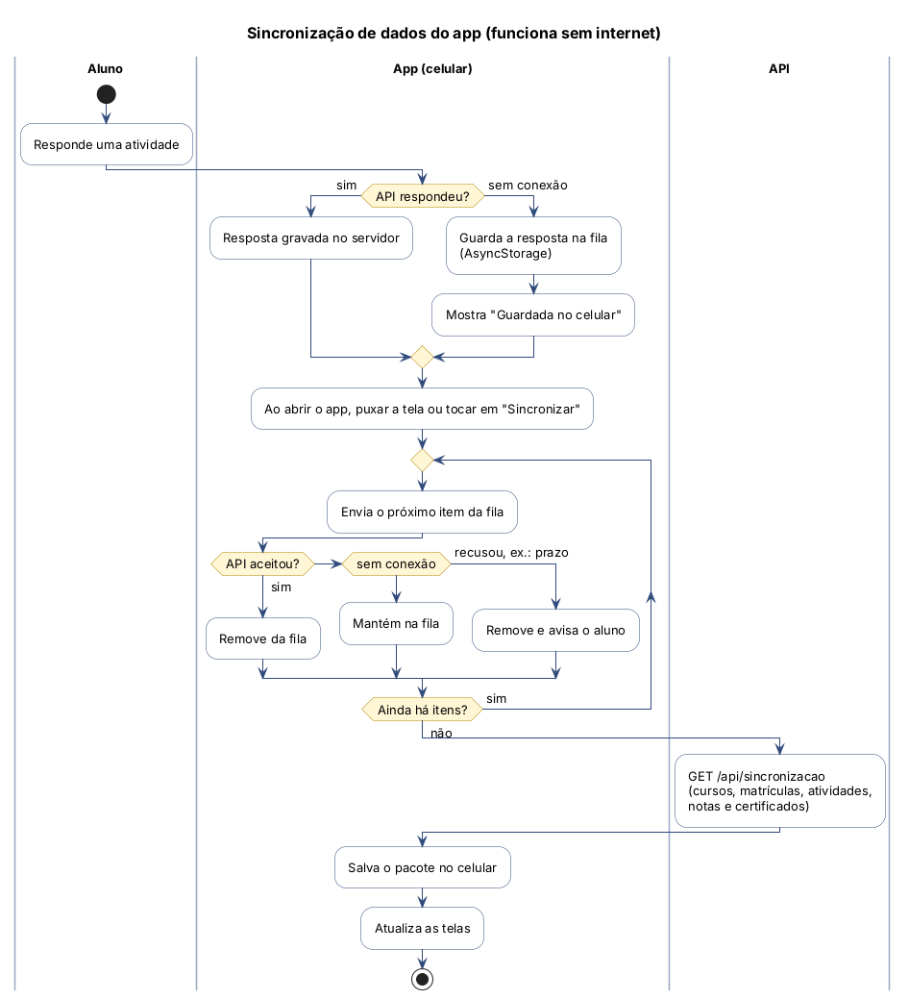
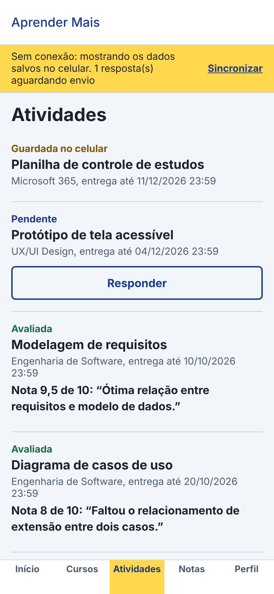
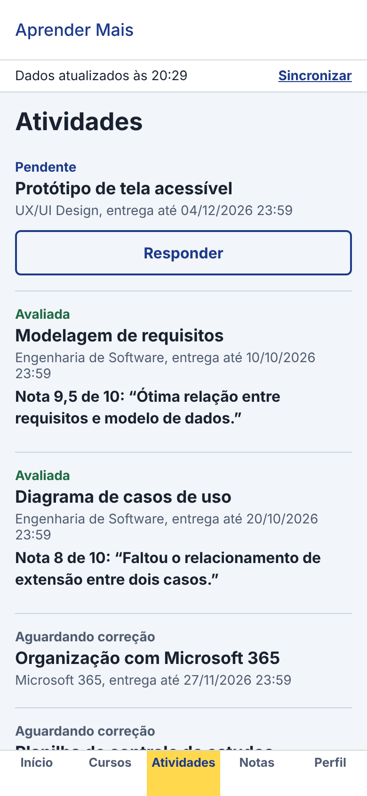

# Etapa 5 – Desenvolvimento da solução Mobile

*Disciplina: Desenvolvimento Mobile*

App para **alunos**, feito em **React Native com Expo** (JavaScript), na pasta `mobile/`. Roda em Android, iOS (pelo app Expo Go) e também no navegador (`npm run web`). Secretaria e administrador usam o site ou o desktop.

## Telas principais

| Login | Início | Atividades | Responder |
|---|---|---|---|
|  |  |  |  |

| Notas | Cursos | Perfil e certificados |
|---|---|---|
|  |  |  |

| Tela | Arquivo | O que faz |
|---|---|---|
| Login | `src/telas/LoginTela.js` | UC01. Só aceita perfil Aluno |
| Cadastro | `src/telas/CadastroTela.js` | UC02. Cria a conta e já entra |
| Início | `src/telas/InicioTela.js` | Matrículas com barra de progresso e atividades pendentes |
| Cursos | `src/telas/CursosTela.js` | Catálogo e matrícula (precisa de internet) |
| Atividades | `src/telas/AtividadesTela.js` | Situação de cada atividade, nota e feedback |
| Responder | `src/telas/ResponderTela.js` | UC04. Envia a resposta ou guarda offline |
| Notas | `src/telas/NotasTela.js` | UC05. Boletim e média geral |
| Perfil | `src/telas/PerfilTela.js` | Certificados com código e botão de sair |

## Fluxo de navegação

- **React Navigation**: uma pilha (*stack*) para Login, Cadastro e Responder, e **abas inferiores** (*bottom tabs*) para Início, Cursos, Atividades, Notas e Perfil.
- Sem login, o app mostra só Login e Cadastro. Depois de logado, mostra as abas (`App.js`).

## Autenticação

1. `LoginTela` chama `POST /api/auth/login`, o mesmo endpoint do site.
2. O token é salvo no **AsyncStorage** do celular, então o aluno continua logado ao reabrir o app.
3. Todas as chamadas enviam `Authorization: Bearer <token>` (`src/servicos/api.js`).
4. Se o token vencer (401), o app limpa os dados e volta para o Login.
5. "Sair da conta" apaga do celular o token, os dados e a fila.

## Sincronização de dados (funciona sem internet)

| Situação | O que acontece |
|---|---|
| Abrir o app | Mostra na hora os dados salvos no celular e sincroniza em seguida |
| Puxar a tela para baixo ou tocar em "Sincronizar" | Envia a fila e baixa tudo de novo |
| Responder **sem internet** | A resposta vai para a **fila** e a atividade aparece como "Guardada no celular" |
| A internet voltou | Na próxima sincronização a fila é enviada e a atividade passa para "Aguardando correção" |
| A API recusou um item da fila (ex.: prazo vencido) | O item sai da fila e o aluno recebe um aviso na tela inicial |

A faixa no topo das telas mostra o estado: *"Dados atualizados às 20:29"* ou, em amarelo, *"Sem conexão: mostrando os dados salvos no celular. 1 resposta(s) aguardando envio"*.

| Sem internet (resposta guardada) | Depois de sincronizar |
|---|---|
|  |  |

Arquivos: `src/servicos/armazenamento.js` (AsyncStorage), `src/servicos/sincronizacao.js` (fila e pacote) e `src/contexto/AppContext.js` (estado global).

## Integração com APIs

| Função | Endpoint |
|---|---|
| Login / dados do usuário | `POST /api/auth/login`, `GET /api/auth/eu` |
| Cadastro | `POST /api/auth/cadastro` |
| **Pacote completo para o celular** | `GET /api/sincronizacao` (cursos, matrículas, atividades, notas, certificados) |
| Matrícula | `POST /api/matriculas` |
| Enviar resposta | `POST /api/respostas` |

O endpoint `/api/sincronizacao` foi criado para o mobile: em **uma única requisição** o app recebe tudo de que precisa para funcionar offline, o que economiza bateria e dados móveis.

O endereço da API é configurado em `src/config.js`: `localhost`, `10.0.2.2` no emulador Android ou o IP do computador para o celular de verdade.
