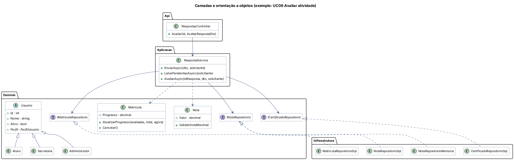

# Etapa 6 – Arquitetura de Software

*Disciplina: Programação Aplicada em .NET*

## Organização em camadas

O back-end (`backend/`) segue uma arquitetura em camadas na qual **as dependências apontam para dentro**: a interface conhece as regras, mas as regras não conhecem a interface nem o banco.

```text
 ┌────────────────────┐   ┌──────────────────────┐
 │ AprenderMais.Api   │   │ AprenderMais.Desktop │   ← Apresentação (como o usuário acessa)
 │ (REST, ASP.NET)    │   │ (Windows Forms)      │
 └─────────┬──────────┘   └──────────┬───────────┘
           └──────────────┬──────────┘
                ┌─────────▼──────────┐
                │ AprenderMais.      │   ← Aplicação: casos de uso (serviços) e DTOs
                │ Aplicacao          │
                └─────────┬──────────┘
                ┌─────────▼──────────┐
                │ AprenderMais.      │   ← Domínio: entidades, regras e interfaces
                │ Dominio            │     (não depende de ninguém)
                └─────────▲──────────┘
                ┌─────────┴──────────┐
                │ AprenderMais.      │   ← Infraestrutura: SQL Server, memória, BCrypt
                │ Infraestrutura     │     (implementa as interfaces do Domínio)
                └────────────────────┘
```

| Camada | Responsabilidade | Exemplos |
|---|---|---|
| **Domínio** | O que o negócio é e suas regras | `Usuario`, `Matricula.AtualizarProgresso()`, `Nota.Validar()`, `IMatriculaRepositorio` |
| **Aplicação** | O que o sistema faz (um serviço por assunto) | `RespostaService.AvaliarAsync()`, `ConteudoService`, DTOs |
| **Infraestrutura** | Como os dados são guardados | `MatriculaRepositorioSql` (ADO.NET + procedures), `...Memoria`, `BCryptPasswordHasher` |
| **Apresentação** | Como o usuário acessa | Controllers da API, telas do Desktop |



## Orientação a objetos

| Conceito | Onde aparece no código |
|---|---|
| **Classe e objeto** | Cada entidade (`Conteudo`, `Atividade`, `Matricula`...) é uma classe. Os repositórios criam objetos a partir das linhas do banco |
| **Encapsulamento** | As regras ficam dentro da própria classe: `Matricula.Cancelar()` impede cancelar uma matrícula concluída, e `Nota.Validar()` impede nota acima da máxima |
| **Herança** | `Aluno`, `Secretaria` e `Administrador` herdam de `Usuario` (abstrata), como no diagrama de classes do PIM III. No banco, isso vira as tabelas `aluno`, `secretaria` e `administrador` ligadas a `usuario` |
| **Polimorfismo** | `Usuario.Perfil` é abstrata e cada subclasse responde com o seu perfil. `Permissoes.ExigirSecretaria()` usa `is`/`as` para tratar o objeto pelo tipo real |
| **Abstração e interfaces** | `IUsuarioRepositorio`, `IPasswordHasher` e `IRelogio` definem o que é necessário, sem dizer como |
| **Injeção de dependência** | Os serviços recebem os repositórios pelo construtor. A API registra tudo em `Program.cs`, e o Desktop monta tudo em `Program.cs` |

## Modularização

- **5 projetos + 1 de testes** na solução `backend/AprenderMais.slnx`, cada um com uma responsabilidade.
- **Troca de banco sem mexer nas regras**: a `FabricaRepositorios` escolhe entre **Memória** (para demonstração e testes) e **SQL Server**, conforme `appsettings.json` → `"Banco:Tipo"`.
- **Reaproveitamento**: Desktop e API usam os mesmos projetos de Domínio e Aplicação.
- **Front-ends independentes**: `web/` e `mobile/` são projetos separados que conversam só pela API REST.
- **Testes automatizados** (`AprenderMais.Testes`, xUnit, 49 testes): testam regras de domínio e serviços usando o banco em memória, com um relógio fixo para os testes de prazo darem sempre o mesmo resultado.

## Alinhamento com Web e Mobile

O mesmo fluxo de **UC06 – Avaliar atividade** passa pelas camadas assim:

1. **Web**: a secretaria clica em "Salvar nota" (`Correcoes.jsx`), que chama `respostas.avaliar()` em `api.js`.
2. **API**: `POST /api/respostas/5/nota`. O `RespostasController` confere o token e o perfil.
3. **Aplicação**: `RespostaService.AvaliarAsync()` valida a nota (`Nota.Validar`), grava, recalcula o progresso (`Matricula.AtualizarProgresso`) e emite o certificado.
4. **Infraestrutura**: `NotaRepositorioSql` faz o `INSERT` (o trigger `trg_nota_validar` confere de novo), e `MatriculaRepositorioSql` chama `sp_calcular_progresso`.
5. **Mobile**: na próxima sincronização, o aluno vê a nota e o novo progresso.
