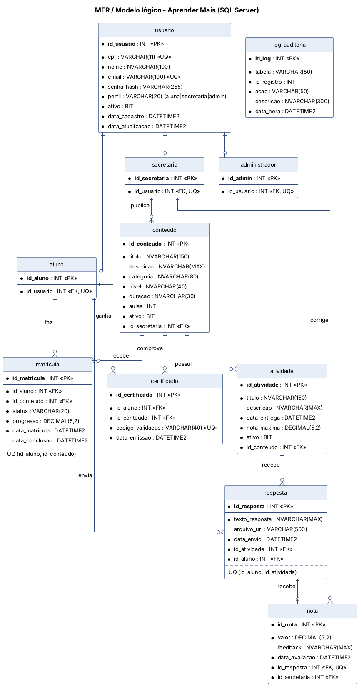

# Etapa 7 – Projeto do Banco de Dados

*Disciplina: Programação de Banco de Dados*

**SGBD:** Microsoft SQL Server 2019 ou superior. No Azure SQL Database, o banco é criado pelo portal e os scripts 02 a 06 são executados conectado direto nele (veja o comentário em `01_criar_banco.sql`).
**Scripts:** pasta [`database/`](../database).

> No PIM III o banco foi modelado em MySQL. No PIM IV ele foi **migrado para SQL Server** por integrar melhor com o .NET e com o Azure. Os tipos foram adaptados (`AUTO_INCREMENT` virou `IDENTITY`, `ENUM` virou `CHECK`, `BOOLEAN` virou `BIT`, `TEXT` virou `NVARCHAR(MAX)`), e foram incluídos procedures, triggers, views e a tabela de auditoria.

## MER (Modelo Entidade-Relacionamento)

O DER original do PIM III continua em [`docs/diagramas/banco`](diagramas/banco) para comparação.

## Modelo lógico

| Entidade | Atributos principais | Relacionamentos |
|---|---|---|
| **usuario** | id_usuario (PK), cpf (UQ), nome, email (UQ), senha_hash, perfil, ativo | 1:1 com aluno, secretaria ou administrador (especialização) |
| **aluno / secretaria / administrador** | id próprio (PK), id_usuario (FK, UQ) | Especializações de usuario |
| **conteudo** | id_conteudo (PK), titulo, categoria, nivel, aulas, ativo | N:1 secretaria (quem publicou); 1:N atividade |
| **atividade** | id_atividade (PK), titulo, data_entrega, nota_maxima, ativo | N:1 conteudo; 1:N resposta |
| **matricula** | id_matricula (PK), status, progresso | N:1 aluno, N:1 conteudo, UQ (aluno, conteúdo) |
| **resposta** | id_resposta (PK), texto, arquivo_url, data_envio | N:1 aluno, N:1 atividade, UQ (aluno, atividade) |
| **nota** | id_nota (PK), valor, feedback | 1:1 resposta (UQ), N:1 secretaria (quem corrigiu) |
| **certificado** | id_certificado (PK), codigo_validacao (UQ) | N:1 aluno, N:1 conteudo, UQ (aluno, conteúdo) |
| **log_auditoria** | id_log (PK), tabela, id_registro, acao, descricao | Preenchida pelos triggers |

**Normalização:** o modelo está na **3ª Forma Normal**. Os dados comuns ficam em `usuario`, os dados de cada perfil ficam em tabelas próprias, e não há atributos repetidos nem dependências transitivas. O progresso (`matricula.progresso`) é o único dado calculado guardado, por desempenho, e é recalculado a cada correção.

## Modelo físico

Definido em [`02_tabelas.sql`](../database/02_tabelas.sql):

| Recurso | Uso |
|---|---|
| `INT IDENTITY(1,1)` | Chaves primárias automáticas |
| `NVARCHAR` | Textos com acentos (nome, título, descrição) |
| `DATETIME2(0)` | Datas em UTC, exceto `data_entrega`, que fica em horário de Brasília |
| `DECIMAL(5,2)` | Notas e progresso (ex.: 9,50 e 66,67) |
| `CONSTRAINT ... CHECK` | `perfil IN (...)`, `status IN (...)`, `progresso BETWEEN 0 AND 100`, `aulas >= 0` |
| `CONSTRAINT ... UNIQUE` | E-mail, CPF, matrícula única por curso, uma resposta por atividade, uma nota por resposta |
| `CONSTRAINT ... DEFAULT` | `ativo = 1`, datas com `SYSUTCDATETIME()` |
| **Índices** (otimização) | `ix_conteudo_ativo`, `ix_atividade_conteudo`, `ix_matricula_aluno`, `ix_resposta_atividade`, `ix_certificado_aluno`... para as consultas mais frequentes |

## Views

| View | Para que serve | Usada em |
|---|---|---|
| `vw_usuario_perfil` | Junta usuario + aluno/secretaria/administrador | `UsuarioRepositorioSql` (todas as leituras de usuário) |
| `vw_respostas_pendentes` | Respostas sem nota (fila de correção) | `RespostaRepositorioSql.ListarPendentesAsync` |
| `vw_boletim` | Notas com aluno, curso e atividade | `sp_relatorio_por_conteudo` |

## Procedures

| Procedure | O que faz | Chamada por |
|---|---|---|
| `sp_cadastrar_usuario` | Insere o usuário **e** a linha do perfil em **uma transação**; recusa e-mail ou CPF repetido (`THROW 50001/50002`) | `UsuarioRepositorioSql.AdicionarAsync` (UC02, UC10) |
| `sp_calcular_progresso` | Conta as atividades avaliadas do aluno e o total do curso | `MatriculaRepositorioSql.ContarAtividadesAsync` (UC06) |
| `sp_emitir_certificado` | Emite o certificado com código `AM-ANO-XXXXXXXX` ou devolve o existente | `CertificadoRepositorioSql.EmitirAsync` |
| `sp_relatorio_resumo` | 9 indicadores do painel do administrador | `RelatorioRepositorioSql.ObterResumoAsync` |
| `sp_relatorio_por_conteudo` | Matriculados, concluídos e média por curso | `RelatorioRepositorioSql` |

## Triggers

| Trigger | Tabela / evento | Regra |
|---|---|---|
| `trg_usuario_auditoria` | usuario, AFTER UPDATE | Atualiza `data_atualizacao` e registra no log quando um usuário é ativado ou desativado (UC11) |
| `trg_conteudo_desativado` | conteudo, AFTER UPDATE | Ao desativar um curso, **desativa as atividades dele** e registra no log (UC09) |
| `trg_nota_validar` | nota, AFTER INSERT/UPDATE | Cancela a gravação se a nota for negativa ou maior que a nota máxima (UC06) |
| `trg_resposta_validar` | resposta, AFTER INSERT | Só aceita resposta dentro do prazo, de atividade ativa e de aluno matriculado (UC04) |

As regras importantes existem **nas duas pontas**: no C# (mensagem amigável para o usuário) e no banco (garantia mesmo se alguém alterar os dados direto no SSMS).

## Script completo

| Arquivo | Conteúdo |
|---|---|
| [`01_criar_banco.sql`](../database/01_criar_banco.sql) | Cria o banco `AprenderMais` |
| [`02_tabelas.sql`](../database/02_tabelas.sql) | Tabelas, chaves, restrições e índices |
| [`03_views.sql`](../database/03_views.sql) | Views |
| [`04_procedures.sql`](../database/04_procedures.sql) | Procedures |
| [`05_triggers.sql`](../database/05_triggers.sql) | Triggers |
| [`06_dados_iniciais.sql`](../database/06_dados_iniciais.sql) | Dados de demonstração |
| [**`script_completo.sql`**](../database/script_completo.sql) | **Todos os anteriores em um arquivo** (o usado pelas APIs, web e mobile) |

Como executar: veja [`database/README.md`](../database/README.md).
