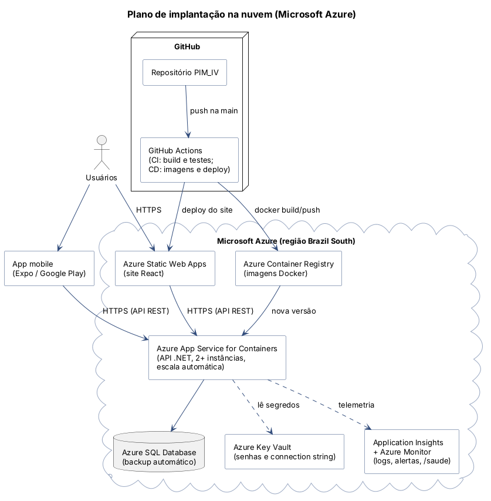

# Etapa 8 – Infraestrutura em Nuvem e DevOps

*Disciplina: Cloud Computing e DevOps (EAD)*

Plano de execução para implantar a solução na **Microsoft Azure**. A parte de **containers e CI** já está pronta no repositório. A implantação na nuvem é o plano descrito abaixo.

## Arquitetura em nuvem



## Serviços utilizados

| Serviço Azure | Função na solução | Por que este serviço |
|---|---|---|
| **Azure App Service for Containers** | Executa a API .NET (imagem Docker) | Serviço gerenciado com HTTPS, escala automática e deploy por imagem |
| **Azure SQL Database** | Banco de dados (mesmos scripts da pasta `database/`) | SQL Server gerenciado, com backup automático e alta disponibilidade |
| **Azure Static Web Apps** | Hospeda o site React (arquivos estáticos) | Plano gratuito, CDN global e HTTPS |
| **Azure Container Registry** | Guarda as imagens Docker geradas no CI | Integração direta com o App Service |
| **Azure Key Vault** | Guarda a connection string e as senhas | Os segredos não ficam no código nem no GitHub |
| **Application Insights / Azure Monitor** | Logs, métricas, alertas e disponibilidade | Monitoramento nativo do .NET |
| **Expo EAS / Google Play** | Distribuição do app mobile | Gera o APK/AAB sem precisar de Android Studio |

Região sugerida: **Brazil South (São Paulo)**, pela menor latência para os alunos.

## Containers

Já implementado no repositório:

| Arquivo | Imagem |
|---|---|
| [`backend/Dockerfile`](../backend/Dockerfile) | API: compila com `dotnet/sdk:10.0` e roda em `dotnet/aspnet:10.0`, uma imagem menor só com o runtime (*multi-stage build*) |
| [`web/Dockerfile`](../web/Dockerfile) | Site: gera o build com `node:22` e serve com `nginx` |
| [`database/Dockerfile`](../database/Dockerfile) | Executa os scripts `.sql` no SQL Server |
| [`docker-compose.yml`](../docker-compose.yml) | Sobe **SQL Server + scripts + API + site** com `docker compose up --build` |

## Pipeline CI/CD

**CI (já implementado)** em [`.github/workflows/ci.yml`](../.github/workflows/ci.yml). A cada push ou pull request na `main`:

```text
push ─▶ backend: build da API + 49 testes xUnit
     ─▶ desktop: build do Windows Forms (runner Windows)
     ─▶ web: lint + build do React
     ─▶ mobile: export do bundle Expo
     ─▶ docker: build das imagens da API e do site (só se os testes passarem)
```

**CD (plano):** depois que o CI passar na `main`:

1. `docker push` das imagens para o **Azure Container Registry** (tag = número do commit).
2. Deploy do site no **Static Web Apps** (action `Azure/static-web-apps-deploy`).
3. Deploy da API no **App Service** em um *slot* de homologação.
4. Teste automático em `GET /saude`; se responder `Healthy`, faz o *swap* do slot para produção (sem tempo fora do ar).
5. Scripts novos de banco são executados com `sqlcmd` usando a connection string do Key Vault.

## Monitoramento

- **Health check**: a API expõe `GET /saude` (`MapHealthChecks`), usado pelo Docker (`HEALTHCHECK`), pelo App Service e pelo teste de disponibilidade.
- **Logs**: erros inesperados são registrados pelo middleware `TratamentoDeErros` (`ILogger`) e enviados ao Application Insights.
- **Alertas**: e-mail para a equipe quando houver mais de 5% de respostas HTTP 500 em 5 minutos, `/saude` fora do ar ou CPU acima de 80%.
- **Auditoria de negócio**: a tabela `log_auditoria` registra ativações e desativações de usuários e conteúdos.

## Escalabilidade

- **API sem estado**: o token vai em cada requisição e os dados ficam no banco, então é possível rodar **várias instâncias** atrás do balanceador do App Service.
- **Escala automática**: regra para ir de 2 até 5 instâncias quando a CPU passar de 70%, por exemplo no período de entrega de atividades.
- **Banco**: Azure SQL permite subir de plano (DTUs/vCores) sem mudar o código. Os índices criados no script reduzem o custo das consultas mais frequentes.
- **Site**: arquivos estáticos em CDN, que escalam sozinhos.
- **Mobile**: o endpoint `/api/sincronizacao` reduz o número de requisições por aluno.
- Ao usar várias instâncias, as chaves de criptografia dos tokens (*Data Protection*) devem ser guardadas em um local compartilhado (Azure Blob Storage + Key Vault), para que um token gerado em uma instância valha em todas.

## Segurança

| Camada | Medida |
|---|---|
| Rede | Somente HTTPS (TLS) no App Service e no Static Web Apps; o banco aceita conexões apenas dos serviços Azure (firewall) |
| Segredos | Connection string no **Key Vault**, lida por *Managed Identity*; nada de senha no código |
| Aplicação | Token Bearer com perfis, BCrypt, consultas parametrizadas, CORS restrito (ver [Etapa 4](04-solucao-web.md#segurança)) |
| Banco | Usuário de banco próprio para a API (sem `sa`), backups automáticos e restauração para um ponto no tempo |
| Pipeline | Os testes precisam passar antes de gerar as imagens; *branch* `main` protegida, com pull request revisado |
| LGPD | Dados mínimos, senha em hash e desativação de conta sob pedido |
