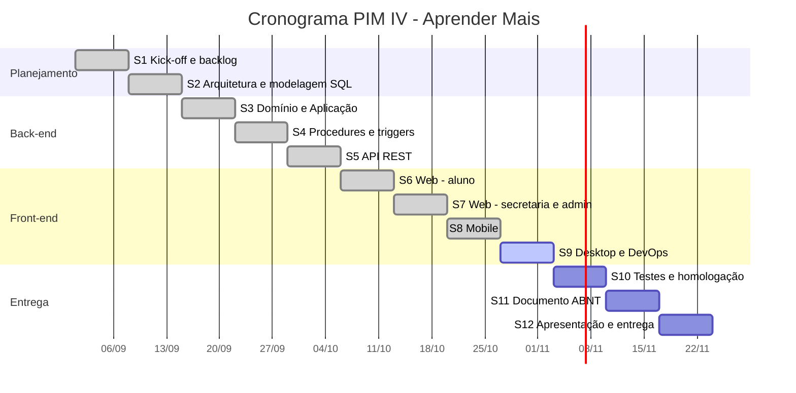

# Etapa 9 – Gerenciamento Ágil do Projeto

*Disciplina: Gerenciamento de Projetos Ágil*

Metodologia: **Scrum** com quadro **Kanban**, em **sprints de 1 semana**, de **01/09/2026 a 23/11/2026** (12 sprints).

## Time Scrum

| Integrante | RA | Papel no Scrum | Foco técnico |
|---|---|---|---|
| Gabriel Souza Maciel | R413020 | Scrum Master | Front-end web (React) e mobile |
| Vitor Gabriel Pereira Geraldo | R8664A1 | Time de desenvolvimento | Back-end C#/.NET e desktop |
| Julia Peneluppi de Faria | R952355 | Product Owner | Requisitos, UX e documentação |
| Lucas Ferreira Tomé | R958752 | Time de desenvolvimento | Banco de dados e DevOps |

**Eventos:** Sprint Planning na terça-feira (início da sprint), Daily de 15 minutos pelo WhatsApp/Discord, Review e Retrospectiva na segunda-feira (fim da sprint).

**Definição de Pronto (DoD):** código no GitHub com pull request revisado, CI verde (build e testes), funcionalidade testada pelo PO e documentação atualizada.

## Product Backlog

As histórias **US01 a US12** vêm do PIM III. As histórias **US13 a US19** e os itens técnicos **T01 a T05** foram incluídos no PIM IV.

| ID | História de usuário | Prioridade | Pontos | Sprint |
|---|---|---|---|---|
| US01 | Como aluno, quero me cadastrar para acessar a plataforma | Alta | 5 | S3, S6 |
| US02 | Como aluno, quero acessar o sistema para utilizar as funcionalidades | Alta | 3 | S3, S5, S6 |
| US03 | Como aluno, quero acessar conteúdos e avaliações | Alta | 8 | S5, S6 |
| US04 | Como aluno, quero realizar avaliações | Alta | 8 | S5, S6 |
| US05 | Como aluno, quero visualizar minhas notas | Alta | 5 | S5, S6 |
| US06 | Como secretaria, quero gerenciar acessos (cadastrar alunos) | Média | 5 | S7 |
| US07 | Como secretaria, quero avaliar atividades | Média | 5 | S5, S7 |
| US08 | Como secretaria, quero adicionar conteúdos | Média | 8 | S3, S7 |
| US09 | Como secretaria, quero editar conteúdos | Média | 5 | S7 |
| US10 | Como secretaria, quero desativar conteúdos | Média | 3 | S3, S7 |
| US11 | Como administrador, quero cadastrar secretaria | Baixa | 5 | S7 |
| US12 | Como administrador, quero desativar cadastros | Baixa | 3 | S7 |
| US13 | Como aluno, quero usar o app no celular mesmo sem internet | Alta | 8 | S8 |
| US14 | Como aluno, quero receber o certificado ao concluir o curso | Alta | 5 | S5 |
| US15 | Como empresa, quero validar um certificado pelo código | Média | 3 | S6 |
| US16 | Como administrador, quero ver relatórios da plataforma | Média | 5 | S7 |
| US17 | Como pessoa com baixa visão, quero aumentar o texto e usar alto contraste | Alta | 3 | S7 |
| US18 | Como secretaria, quero criar atividades com prazo para os cursos | Média | 5 | S5, S7 |
| US19 | Como secretaria/administrador, quero usar o sistema no computador (desktop) | Média | 8 | S9 |
| T01 | Banco SQL Server com procedures, triggers e views | Alta | 8 | S2, S4 |
| T02 | API REST com autenticação por token e Swagger | Alta | 8 | S5 |
| T03 | Testes automatizados (xUnit) | Média | 5 | S3, S5 |
| T04 | Docker, docker-compose e CI no GitHub Actions | Média | 5 | S9 |
| T05 | Documento ABNT e apresentação | Alta | 8 | S11, S12 |

**Total:** 128 pontos. **Velocidade média planejada:** cerca de 11 pontos por sprint.

## Cronograma das sprints

| Sprint | Período | Objetivo | Status |
|---|---|---|---|
| S1 | 01/09 – 07/09 | Kick-off, revisão do PIM III, Etapas 1 e 2, Product Backlog do PIM IV | Concluída |
| S2 | 08/09 – 14/09 | Arquitetura em camadas e migração do banco para SQL Server (MER e modelos) | Concluída |
| S3 | 15/09 – 21/09 | Domínio e Aplicação em C#: login, conteúdos e matrículas, com testes | Concluída |
| S4 | 22/09 – 28/09 | Procedures, triggers, views, dados iniciais e repositórios SQL | Concluída |
| S5 | 29/09 – 05/10 | API REST, token Bearer, Swagger; atividades, respostas, notas e certificados | Concluída |
| S6 | 06/10 – 12/10 | Site React: estrutura, login, cadastro e área do aluno | Concluída |
| S7 | 13/10 – 19/10 | Site React: secretaria, administração, relatórios e acessibilidade | Concluída |
| S8 | 20/10 – 26/10 | App mobile: telas, navegação e sincronização offline | Concluída |
| S9 | 27/10 – 02/11 | Desktop WinForms, diagramas de atividade, Docker e CI, Etapas 3 e 8 | **Em andamento** |
| S10 | 03/11 – 09/11 | Testes integrados com SQL Server, homologação com usuários e correções | Planejada |
| S11 | 10/11 – 16/11 | Documento final em ABNT (20 a 30 páginas), resumo, abstract e referências | Planejada |
| S12 | 17/11 – 23/11 | Revisão final, ensaio da apresentação, postagem na UNIP e cópia impressa | Planejada |

## Sprint Backlog

### S1 – Kick-off e planejamento (01/09 – 07/09)
- [x] Reler o manual do PIM IV e dividir as etapas entre o time (Julia)
- [x] Revisar requisitos, casos de uso e diagramas do PIM III (todos)
- [x] Escrever Etapa 1 – Caracterização da organização (Julia)
- [x] Escrever Etapa 2 – Planejamento, modelo de negócio e viabilidade (Julia, Gabriel)
- [x] Atualizar o Product Backlog com US13 a US19 e T01 a T05 (Julia)
- [x] Definir a stack: .NET 10, React, Expo e SQL Server (Vitor, Gabriel)

### S2 – Arquitetura e modelagem (08/09 – 14/09)
- [x] Definir as camadas Domínio, Aplicação, Infraestrutura e Apresentação (Vitor)
- [x] Migrar o modelo MySQL do PIM III para SQL Server (Lucas)
- [x] MER, modelo lógico e modelo físico (Lucas)
- [x] Script `02_tabelas.sql` com chaves, restrições e índices (Lucas)

### S3 – Domínio e Aplicação (15/09 – 21/09)
- [x] Entidades com regras: Usuario e perfis, Conteudo, Matricula, Nota... (Vitor)
- [x] Serviços de autenticação, conteúdo, matrícula e usuário (Vitor) – US01, US02, US08, US10
- [x] Repositórios em memória com dados de demonstração (Vitor)
- [x] Testes xUnit das regras e serviços (Vitor) – T03

### S4 – Banco de dados (22/09 – 28/09)
- [x] Views `vw_usuario_perfil`, `vw_respostas_pendentes`, `vw_boletim` (Lucas)
- [x] Procedures de cadastro, progresso, certificado e relatórios (Lucas)
- [x] Triggers de auditoria, desativação, validação de nota e de prazo (Lucas)
- [x] Dados iniciais e `script_completo.sql` (Lucas)
- [x] Repositórios SQL Server com ADO.NET (Vitor, Lucas) – T01

### S5 – API REST (29/09 – 05/10)
- [x] Projeto `AprenderMais.Api`, controllers, Swagger e CORS (Vitor) – T02
- [x] Autenticação por token Bearer e autorização por perfil (Vitor)
- [x] Serviços de atividades, respostas, notas e certificados (Vitor) – US03, US04, US05, US07, US14, US18
- [x] Middleware de erros e health check (Vitor)

### S6 – Web: aluno (06/10 – 12/10)
- [x] Estrutura React (Vite), rotas, contexto de login e `api.js` (Gabriel)
- [x] Telas Início, Entrar e Cadastro (Gabriel) – US01, US02
- [x] Meus estudos, Cursos, Atividades, Notas e Certificados (Gabriel) – US03, US04, US05
- [x] Validação pública de certificado (Gabriel) – US15

### S7 – Web: secretaria e administração (13/10 – 19/10)
- [x] Correções, Conteúdos (CRUD) e Nova atividade (Gabriel) – US07 a US10, US18
- [x] Cadastrar aluno e Usuários (Gabriel) – US06, US11, US12
- [x] Painel com relatórios (Gabriel, Lucas) – US16
- [x] Barra de acessibilidade, alto contraste e revisão WCAG (Julia, Gabriel) – US17

### S8 – Mobile (20/10 – 26/10)
- [x] Projeto Expo, navegação em pilha e abas (Gabriel)
- [x] Telas Login, Cadastro, Início, Cursos, Atividades, Responder, Notas e Perfil (Gabriel)
- [x] Endpoint `/api/sincronizacao` (Vitor)
- [x] Cache no AsyncStorage e fila offline de respostas (Gabriel) – US13

### S9 – Desktop e DevOps (27/10 – 02/11) – em andamento
- [x] Desktop Windows Forms: login e telas por perfil (Vitor) – US19
- [x] Abas "Minhas notas" e "Corrigir atividades" no desktop (Vitor)
- [x] Diagramas de atividade UC01 a UC11 (Gabriel)
- [x] Dockerfiles, docker-compose e CI no GitHub Actions (Lucas) – T04
- [x] Etapa 3 – Responsabilidade social e Etapa 8 – Nuvem e DevOps (Julia, Lucas)
- [ ] Rodar o sistema completo com SQL Server nas máquinas do time (todos)

### S10 – Testes e homologação (03/11 – 09/11)
- [ ] Teste ponta a ponta com SQL Server (web, mobile e desktop)
- [ ] Teste com 3 usuários reais (aluno, secretaria e admin) e registro dos ajustes
- [ ] Correção de bugs encontrados
- [ ] Capturas de tela finais para o documento

### S11 – Documento ABNT (10/11 – 16/11)
- [ ] Capa, folha de rosto, resumo e abstract
- [ ] Introdução, desenvolvimento (Etapas 1 a 9) e conclusão
- [ ] Referências no padrão ABNT e revisão de formatação

### S12 – Entrega (17/11 – 23/11)
- [ ] Revisão final e verificação de plágio
- [ ] Ensaio da apresentação
- [ ] Postagem no sistema de trabalhos acadêmicos da UNIP e cópia impressa

## Quadro Kanban (situação na Sprint 9)

| A fazer | Fazendo | Em revisão | Concluído |
|---|---|---|---|
| Testes integrados com SQL Server (S10) | Rodar o sistema com SQL Server nas máquinas do time | Etapas 3 e 8 (revisão do PO) | US01 a US18 |
| Homologação com usuários (S10) | | | T01, T02, T03, T04 |
| Documento ABNT (S11) | | | Desktop (US19) |
| Apresentação e entrega (S12) | | | Diagramas de atividade |

> Sugestão: replicar este quadro no **GitHub Projects** (aba *Projects* do repositório → *New project* → *Board*), com uma *issue* para cada item do backlog. Assim o Kanban fica ligado aos commits e pull requests.

## Definição das entregas

| Entrega | Conteúdo | Sprint | Critério de aceite |
|---|---|---|---|
| E1 – Planejamento | Etapas 1 e 2 e Product Backlog | S1 | Aprovado pelo PO |
| E2 – Banco de dados | Scripts 01 a 06 e `script_completo.sql` | S4 | Script roda do zero no SQL Server sem erros |
| E3 – API | API REST documentada no Swagger | S5 | Todos os endpoints respondem; 49 testes passando |
| E4 – Web | Site com os 3 perfis | S7 | Fluxo completo aluno → secretaria → certificado |
| E5 – Mobile | App do aluno com modo offline | S8 | Resposta offline enviada após a sincronização |
| E6 – Desktop e DevOps | Desktop WinForms, Docker e CI | S9 | CI verde no GitHub; `docker compose up` funcionando |
| E7 – Documento final | PIM em ABNT (20 a 30 páginas) | S11 | Checklist ABNT do manual atendido |
| E8 – Entrega oficial | Postagem e apresentação | S12 | Postado dentro do prazo |
